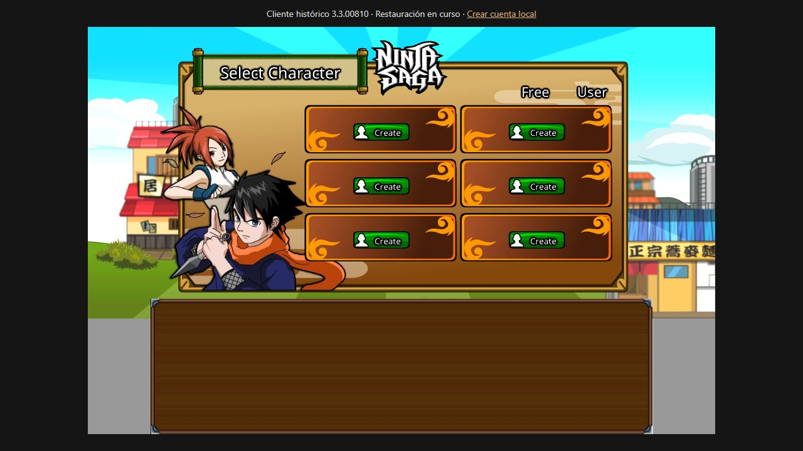

# Ninja Saga · Restauración 1:1 / Preservation

Restauración comunitaria del Ninja Saga histórico y trabajo hacia un traslado fiel a HTML5. Conservamos su interfaz, animaciones y mecánicas, contrastando cada cambio con los archivos recuperados. Proyecto independiente; no es un servicio oficial.

**Hito actual:** cliente histórico con sus bibliotecas originales, acceso local sin Facebook y pantalla original de selección de personajes. **La restauración completa y el port nativo HTML5 siguen en desarrollo.**

## Prueba pública

**[Abrir Ninja Saga](https://ninja-saga-restoration.heartyglade5.chatgpt.site)** — no necesitas ejecutar localhost ni instalar nada. Crea una cuenta de pruebas desde el enlace de la página y entra en la pantalla original del juego.

Por ahora se pueden probar el registro, el acceso y la selección original de personajes. La creación de personajes y las misiones siguen en restauración. [Reportar un problema](https://github.com/sukyozumaru/ninja-saga-html5/issues).

El servidor y las cuentas están alojados de forma independiente del ordenador del desarrollador. [Informe de publicación y pruebas](restoration/INFORME-03.md). El código del alojamiento se conserva en `hosting/`.



## Probar el cliente histórico

Necesitas Node.js 18 o posterior. No hay dependencias npm que instalar.

```sh
git clone https://github.com/sukyozumaru/ninja-saga-html5.git
cd ninja-saga-html5
npm start
```

Abre **http://localhost:8082/**. Crea una cuenta en el enlace de la página y entra desde la pantalla original de usuario y contraseña. En Windows también puedes abrir `Iniciar-Historico.cmd`.

El servidor solo escucha en tu ordenador. Cuentas y hashes de contraseña se guardan en `historical/runtime/`, excluido de Git. Las sesiones caducan y se invalidan al reiniciar. No existen cuentas ni partidas originales recuperadas.

## Estado real

| Área | Estado |
|---|---|
| SWF principal, código, red, popup, idioma y datos históricos | Cargan sin modificar los binarios |
| Acceso local y selección de personajes | Verificados en el navegador con AMF real |
| Recursos archivados | Colección 3.3.00810 preservada con manifiesto SHA-256 |
| Creación de personajes | Bloqueada al cargar `hair_10_1.swf`, ausente del archivo histórico |
| Persistencia de personajes, misiones y servicios sociales históricos | Pendientes de reconstrucción y validación |
| Port nativo HTML5 completo | Pendiente; Ruffle se usa como herramienta de preservación |

El cliente acepta el parámetro original `client_version=3.3.00810`, correspondiente a la carpeta archivada. Su constante interna inicial dice 3.3.00809; conservamos ambos valores. No se cargan bibliotecas comunitarias en este perfil, ni se generan recursos sustitutos o éxitos simulados.

## Ayuda a recuperarlo

Buscamos experiencia en **ActionScript/AVM2, AMF, preservación de SWF, timelines y migración HTML5**. También sirven capturas, vídeos y archivos originales con evidencia de versión. Empieza por [cómo contribuir](CONTRIBUTING.md), abre una [issue](https://github.com/sukyozumaru/ninja-saga-html5/issues) o comparte este proyecto. Una estrella ayuda a que otros interesados lo encuentren.

## Evidencia y comprobaciones

- [Alcance de restauración](RESTORATION.md).
- [Análisis AS3 y arquitectura](restoration/INFORME-01.md).
- [Arranque histórico, login y límites comprobados](restoration/INFORME-02.md).
- `restoration/as3/`: exportaciones separadas por biblioteca; no equivalen al proyecto editable original.
- `restoration/historical-assets/`: extracción histórica sin modificar; origen y SHA-256 en `historical-assets.json`.

```sh
npm run test:historical
npm run verify:historical
```

El runner comunitario anterior permanece mediante `npm run start:community` en http://localhost:8080/ o `Iniciar-Local.cmd`. Sus pruebas de aldea/combate no demuestran que esos servicios estén restaurados en el perfil histórico. Sus respuestas simuladas y parches no se adoptan como comportamiento original.

## English

We are preserving the historical Ninja Saga client and working toward a faithful HTML5 migration. The current milestone runs the unmodified historical SWF with its own archived libraries and a local replacement login, reaching the original character selection UI. It is not yet a complete playable restoration or a native HTML5 port. Missing resources and unreconstructed server contracts fail explicitly instead of being replaced with fake success responses.

**[Try the public preview](https://ninja-saga-restoration.heartyglade5.chatgpt.site)** — create a test account and sign in through the original game screen. Registration, login and original character selection are available; character creation and missions are still under restoration.

Clone this repository, run `npm start`, visit http://localhost:8082/, create a local account, and sign in through the original game screen. See [CONTRIBUTING.md](CONTRIBUTING.md) for ways to help. Share the project with preservation and ActionScript communities if you would like to support the effort.

Los recursos originales conservan sus derechos y licencias de procedencia. Este repositorio no concede una licencia sobre Ninja Saga ni sus recursos. Fuentes: [Internet Archive](https://archive.org/details/ninja_saga), [shenjai47/NinjaSaga](https://github.com/shenjai47/NinjaSaga). Ruffle se distribuye con sus avisos de licencia en `local/public/ruffle/`.
